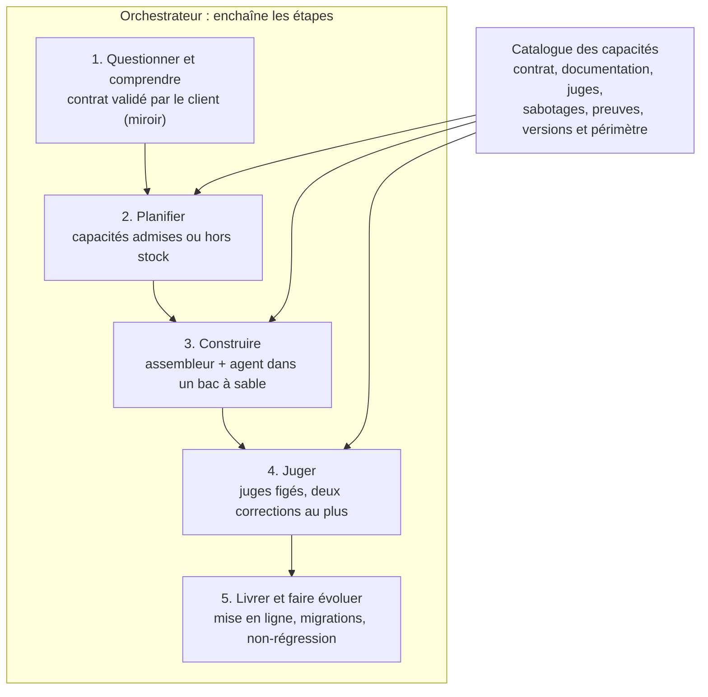

# Usine à apps — rapport de décisions, version 2

12 novembre 2026 · Arthur

## En bref : les décisions à ce jour

Ce rapport rassemble ce qui a été décidé après les recherches de Claude et deux échanges avec une autre IA. Les deux IA considèrent désormais le concept comme stable : la suite, ce sont des expériences.

1. **L'usine est un outil, pas un produit.** Le business est mis de côté tant qu'elle ne fonctionne pas.
2. **Le concept : une usine qui grandit par capacités admises.** Une capacité est un comportement (par exemple « notifier par e-mail le bon destinataire après un événement autorisé »), avec son contrat, ses juges, ses sabotages et son dossier de preuve.
3. **Ce qui fait la valeur de l'usine :** le contrat validé par le client (le miroir), les juges, le catalogue des capacités et l'orchestrateur. Le constructeur (agent, modèle, assembleur) est interchangeable.
4. **Une preuve dit toujours ses limites.** L'usine distingue ce qu'elle a vérifié, les familles de défauts qu'elle sait détecter, et ce qui reste hors de son contrôle. Un juge est qualifié par les sabotages qu'il attrape **et** par les apps conformes qu'il accepte.
5. **L'agent :** pas de nouvelle boucle d'agent. mini-swe-agent, dans sa version officielle, en premier ; OpenCode en comparaison ; les deux avec le même modèle.
6. **L'assembleur reste, sans être obligatoire.** Il ne garde que ce qu'il fait mieux que l'agent, et cela se mesure.
7. **L'apprentissage autonome est un objectif de recherche, pas le cœur.** D'abord : ajouter une seule capacité à la main (l'e-mail), puis la réutiliser dans d'autres apps.
8. **La pile des apps produites est conservée** (Next.js, ZenStack, PostgreSQL, Tailwind et shadcn/ui). **Better Auth** est le choix provisoire des deux IA pour les comptes. Les autres technologies se choisissent capacité par capacité.
9. **Chaque construction laisse des traces dès maintenant :** modèle, agent, versions, coûts, résultats des juges.
10. **La suite :** six étapes, en commençant par qualifier un petit noyau de juges, puisqu'ils servent à mesurer tout le reste.

### Ce qui change depuis la version 1

- Le moteur d'agent est tranché : mini-swe-agent officiel en premier, plus de « version maison ».
- Les juges sont aussi testés contre les **faux positifs** : un juge qui refuse toutes les apps attraperait tous les sabotages et ne servirait à rien.
- Un niveau est **couvert** par un catalogue fini et versionné, plutôt qu'« appris ».
- La capacité e-mail a un contrat précis, 12 juges et deux niveaux d'essai (voir sa section).
- Les parcours d'écrans ont un format, et les échecs de juge sont classés en quatre sortes.
- Le plan d'expériences est réordonné, avec des règles de décision renforcées.
- Better Auth n'est plus en débat ; NocoBase reste un point de comparaison, avec une réserve de licence.

## Le contexte

### Qui et pourquoi

Arthur est développeur au Québec. Il travaille seul, sur un PC Windows, avec un budget IA limité, accompagné d'un agent de code (Claude Code) qui connaît tout le dépôt du projet. Il peut acheter des jetons chez Anthropic, OpenAI ou ailleurs. En revanche, il ne veut pas que l'usine dépende d'un agent en ligne de commande précis (Claude Code, Codex ou autre).

Son intention : construire **sa propre usine à apps**, qui automatise complètement le développement d'apps web, de la demande d'un client jusqu'à l'app en ligne, puis son évolution. Pas pour concurrencer les plateformes du marché, mais pour développer plus vite et mieux qu'en recopiant du code généré par une IA. L'usine progresse par niveaux :

1. gestion simple (fiches, rôles, droits, étapes) ;
2. gestion enrichie (calculs, tableaux de bord, recherche, calendrier, fichiers, imports, e-mails) ;
3. apps connectées (paiement, SMS, WhatsApp, intégrations) ;
4. temps réel et tâches de fond ;
5. apps avec de l'IA à l'intérieur ;
6. plateformes.

### Ce qui a été construit et appris

- **Usine 1 (mars à septembre 2026).** Une IA « architecte » produisait une déclaration, une vingtaine de générateurs de code fixes écrivaient l'essentiel, et un exécuteur IA fait maison (modèles de classe gpt-4o) faisait le reste ; environ 23 000 lignes d'orchestration. Le 28 septembre, deux demandes inédites ont donné zéro compilation réussie. L'IA avait bien compris les demandes ; c'est le code fixe qui cassait.
- **Usine 2 (octobre 2026).** Des lecteurs IA transforment la demande en une `Description` typée. Le client la valide dans un « miroir », et une porte bloque toute fabrication non validée. Un assembleur pose des pièces écrites une fois (Next.js 16, ZenStack v3, PostgreSQL), en 3 min 27 s par app. Le juge des règles est prouvé par sabotage : 205 erreurs sur 214 attrapées en v1.0, 85 à 86 % en v1.2. Les tests d'écran sont prouvés, mais seulement sur le squelette de l'usine. 33 vraies demandes ont été traitées et 59 corrections faites, chacune pour une classe de défaut. Limites : la gestion simple seulement, rien n'est hébergé, la connexion est simulée (Clerk était prévu, jamais branché).
- **Preuve de concept (20 au 22 octobre).** Même demande réelle, même modèle (Sonnet 5.5 dans Claude Code) :
  - A1, l'agent avec notre description et notre matrice des droits : 41 minutes, environ 8 USD, 253 cas sur 258 au juge des règles.
  - A2, avec en plus le rapport du juge : 258 sur 258 en une seule correction.
  - Évolution : l'agent a migré 52 lignes sur 52 avec sauvegarde, là où l'usine n'en migrait aucune.
  - A0, la demande seule : 1 h 02, environ 7,50 USD, les 11 demandes servies, une app jugée plus riche que celle de l'usine, une seule faille (l'annuaire du personnel lisible par n'importe quelle personne connectée).
  - Conclusion : un agent du commerce construit aussi bien que l'usine ; nos juges attrapent ce qu'il laisse passer.

### Ce qui manque aujourd'hui

Selon l'inventaire de l'agent local (10 novembre) :

- le juge générique, qui relève ce que la base permet vraiment rôle par rôle, n'est pas prouvé par sabotage ;
- aucun juge d'écrans ne sait juger une app écrite librement par un agent ;
- la construction sans humain n'est pas prouvée : le mode non interactif de Claude Code a été refusé par l'outil de sécurité de la session ;
- la variance (deux constructions de la même demande) n'a jamais été mesurée ;
- rien n'est livré : pas d'hébergement, pas de vrais comptes, pas de sauvegardes.

### Les échanges qui ont mené à ce rapport

- Une recherche de Claude (11 novembre) : idées, état de l'art, technologies.
- Un premier audit de cette recherche par une autre IA (11 novembre), qui a corrigé plusieurs points.
- La version 1 de ce rapport (11 novembre).
- La réponse de l'autre IA à cette version 1 (11 novembre). Elle valide le concept et renforce la définition de la preuve, les juges, les parcours d'écrans et le plan d'expériences.
- Cette version 2 (12 novembre), qui intègre ces renforcements.

## Le concept retenu

**L'usine transforme une demande en contrat vérifiable, le fait réaliser par un constructeur interchangeable, et décide avec des preuves exécutables ce qui est conforme. Elle grandit en ajoutant des capacités admises.**

L'ambition de départ ne change pas : automatiser complètement, niveau par niveau. Elle est reformulée ainsi, à la suite de l'audit : étendre de façon contrôlée et vérifiable ce que l'usine sait produire, quels que soient l'agent et le modèle utilisés. L'apprentissage autonome deviendra une propriété de cette usine si les expériences montrent qu'il est fiable ; ce n'est pas le point de départ.

### Une capacité admise

Une capacité est un **comportement**, pas une technologie : « notifier par e-mail le bon destinataire après un événement autorisé », et non « savoir utiliser Resend ». Elle est admise quand son dossier est complet :

- **son contrat** : ce qu'elle reçoit, ce qu'elle garantit, ce qu'elle interdit ;
- **la documentation à donner à l'agent**, injectée à chaque tâche ;
- **ses juges**, de trois sortes : universels (aucune fuite de secret, aucune erreur d'exécution), de capacité (le bon destinataire, pas de doublon), contextuels (dans cette app, seul le responsable approuve) ;
- **ses sabotages**, et le rapport qui montre que les juges les attrapent ;
- **les versions** des technologies avec lesquelles elle a été prouvée, et son **périmètre** ;
- **son état** : candidate, admise, ou devenue incompatible après une mise à jour.

Un niveau est **couvert** quand un catalogue fini et versionné de capacités est admis pour un périmètre déterminé. Sans cette frontière, le niveau 2 deviendrait une cible mouvante : calculs, fichiers, e-mails, recherche et calendriers ont une infinité de variantes.

### Apprendre à vérifier avant d'apprendre à construire

« Apprendre » une capacité peut vouloir dire deux choses :

- **apprendre à construire** : enseigner à l'agent comment faire ;
- **apprendre à vérifier** : écrire le contrat, les juges et les sabotages de la capacité.

Les modèles savent souvent déjà construire, mais ils laissent passer des erreurs : la preuve de concept l'a montré. La seconde moitié est donc toujours nécessaire. La première ne l'est que si l'agent échoue de façon répétée sur une capacité ; l'expérience sur l'e-mail le dira.

### Trois règles

- **Ce qui fabrique est flexible, ce qui contrôle est fixe et prouvé.** C'est la leçon de l'usine 1, dont le code fixe de fabrication cassait.
- **Celui qui construit ne peut ni modifier ses critères d'acceptation, ni choisir les cas de validation finale, ni effacer ses échecs.** Cette formulation, proposée par l'autre IA, remplace l'idée de trois agents obligatoirement différents.
- **Une preuve dit toujours ses limites.** L'usine distingue ce qu'elle a effectivement vérifié, les familles de défauts qu'elle sait détecter, et les comportements qui restent hors de son contrôle. Un juge est qualifié par les sabotages qu'il attrape et par les apps conformes qu'il accepte. Et une IA n'est jamais l'oracle d'un résultat qu'elle vient de produire. Sans cette règle, une usine qui produit vite deviendrait aussi une usine qui certifie trop facilement ses propres erreurs.

## L'architecture

L'usine est un orchestrateur qui enchaîne cinq étapes, alimentées par un catalogue de capacités. **L'agent constructeur** n'intervient qu'à l'étape de construction. D'autres interventions d'IA existent : l'analyste qui pose les questions au client, et plus tard les agents qui rédigent des juges candidats. Chacune a ses propres permissions et son propre contrat.

*L'agent constructeur n'agit qu'à une étape ; le catalogue sert les autres.*

Si les juges refusent, l'agent corrige. Deux tentatives est une valeur de départ, pas une loi : l'agent est arrêté plus tôt s'il répète exactement la même erreur, et la règle s'ajustera selon la gravité des défauts, le coût consommé et les progrès réels.

### Ce que fait chaque étape

1. **Questionner et comprendre.** Un agent « analyste » lit la description du client, repère les trous et les ambiguïtés, et pose les questions. Les lecteurs et le critique de l'usine 2 font déjà une partie de ce travail. Le résultat est la `Description` typée, validée par le client dans le miroir : c'est le contrat. Il contient aussi les parcours d'écrans attendus (voir plus bas).
2. **Planifier.** L'usine compare le contrat au catalogue. Une partie **non admise** au catalogue peut être construite à titre expérimental, comme une prévisualisation. Elle n'échappe jamais aux contrôles minimaux de sécurité et d'intégrité, et seule une app dont toutes les capacités sont admises peut être livrée.
3. **Construire.** L'assembleur pose ce qu'il sait faire, puis l'agent constructeur fait le reste dans un bac à sable. Il reçoit le contrat, la documentation des capacités nécessaires (injectée dans `AGENTS.md`), les conventions de noms et les doctrines.
4. **Juger.** Les juges sont figés : l'agent ne peut ni les lire à l'avance, ni les modifier. Chaque échec est classé en quatre sortes, parce qu'elles n'appellent pas la même réponse :
   - **échec fonctionnel confirmé** : l'action a été faite, le résultat est faux ;
   - **échec de navigation** : le juge n'a pas trouvé ou pas réussi l'action ;
   - **contrat ambigu** : plusieurs lectures sont possibles ;
   - **échec d'environnement** : navigateur, réseau ou infrastructure.

   Seul le premier est un verdict de non-conformité. Un échec de navigation n'en devient jamais un automatiquement.
5. **Livrer et faire évoluer.** Mise en ligne, vrais comptes, sauvegardes. Chaque demande de changement repasse par la même chaîne, avec une migration sauvegardée et la preuve que rien n'a régressé.

### Les parcours d'écrans dans le miroir

Un parcours décrit un comportement, jamais une interface : « approuver la demande D-101 », pas « cliquer sur le troisième bouton ». Il a sept éléments, proposés par l'autre IA à partir de la méthode EARS :

| Élément | Exemple |
| --- | --- |
| Acteur | Responsable |
| État initial | Une demande est en attente |
| Objet | Demande D-101 |
| Action | Approuver la demande |
| Résultat visible | Statut « Approuvée » |
| Résultat métier | Nouvelle approbation enregistrée |
| Interdiction | Un employé ordinaire ne peut pas approuver |

Le juge d'écrans reçoit ce parcours et le réalise sur l'interface construite, en ciblant les éléments par leur rôle et leur libellé, comme le recommande Playwright. Ce qui est générique, c'est le moteur qui exécute ; ce qui change d'une app à l'autre, c'est le parcours.

### Ce qu'on construit, ce qu'on prend

| Composant | Construit ou pris ? | Pourquoi |
| --- | --- | --- |
| Orchestrateur | **Construit** | C'est le chef de chantier, propre à l'usine |
| Catalogue des capacités | **Construit** | C'est la mémoire de l'usine et ce qui la fait grandir |
| Juges | **Construits**, en partie existants | Personne d'autre ne vérifie l'app contre le contrat du client |
| Compréhension et miroir | **Construits**, en partie existants | Il manque la page où le client répond et valide |
| Assembleur | Existe, à mesurer | Gardé seulement là où il fait mieux que l'agent |
| Boucle d'agent | Minimale ou prise toute faite | Voir la section suivante |
| Modèles | Achetés | Jetons Anthropic ou OpenAI, modèle local plus tard |
| Bac à sable, base de données, hébergement | Pris en open source | Docker, PostgreSQL, Coolify |

### Les traces

Chaque construction enregistre le modèle et l'agent utilisés, les versions, les étapes, les jetons et le coût, les modifications, les résultats des juges, les sabotages et les corrections. Une table dans PostgreSQL et un dossier par construction suffisent au départ. Sans ces traces, impossible de savoir si l'usine progresse ou répète les mêmes erreurs.

## L'environnement d'agent

**Décision : pas de nouvelle boucle d'agent. mini-swe-agent, dans sa version officielle, est intégré comme moteur interchangeable ; OpenCode sert de comparaison, piloté par son API. Les deux moteurs sont comparés avec le même modèle ; ensuite seulement, on compare des modèles avec un moteur fixé.**

### Construire le sien : faisable ?

- **Faisable, dans sa version minimale.** [mini-swe-agent](https://github.com/SWE-agent/mini-swe-agent), de l'équipe de Princeton et Stanford qui a créé SWE-bench, tient en une centaine de lignes de Python. Il n'utilise que le terminal, garde un historique linéaire, et dépasse 74 % sur SWE-bench Verified avec certaines configurations. Ce score ne mesure pas la construction d'apps complètes comme les tiennes.
- **Mais inutile à réécrire.** Le travail d'Arthur, c'est l'orchestrateur. Intégrer la version officielle évite de maintenir une deuxième boucle.
- **Ce que les grandes équipes ajoutent dans Claude Code :** le confort d'un humain qui travaille avec l'agent (interface, permissions fines, mode plan, intégration à l'éditeur). L'usine en a peu besoin : ses tâches sont précises, et ce sont les juges qui disent quand c'est fini.
- **Ce qui serait irréaliste :** refaire Claude Code en entier.
- **Le précédent :** l'exécuteur fait maison de l'usine 1 a contribué à son échec, mais avec des modèles de classe gpt-4o et sans juges fiables. Ces deux conditions ont changé.

### Les options

| Option | Langage | Atouts | Limites | Ordre d'essai |
| --- | --- | --- | --- | --- |
| mini-swe-agent, version officielle | Python, comme l'usine | Une centaine de lignes, lisible, tout modèle, Docker, limites de coût et d'étapes | Historique linéaire : longues constructions à mesurer | 1 |
| OpenCode, piloté par son API | TypeScript | Sessions programmables, permissions, plusieurs fournisseurs | Permissions permissives par défaut, isolement à organiser | 2 |
| OpenHands | Python, TypeScript, API REST | Espaces de travail éphémères en conteneurs | Intégration plus lourde | En réserve |
| Goose | API et ligne de commande | Polyvalent, MCP | Moins spécialisé dans la construction logicielle | En réserve |
| Claude Code | — | Référence de qualité | Dépendance à un outil précis | Référence seulement |

L'autre IA recommandait d'abord OpenCode, en supposant une usine écrite en TypeScript. Informée que l'usine est en Python, elle a révisé sa position : mini-swe-agent officiel en premier.

### Le vrai risque des longues constructions

A0 a duré une heure. Le danger n'est pas l'absence d'outils d'édition sophistiqués, mais l'accumulation de contexte sur une longue trajectoire. Tableau repris de l'autre IA :

| Risque | Conséquence possible |
| --- | --- |
| Historique qui grossit sans cesse | Contexte saturé, coût qui monte, informations anciennes perdues |
| Sorties de commandes volumineuses | Journaux et erreurs qui mangent le contexte utile |
| Travail interrompu | Reprise difficile sans réexaminer tout le dépôt |
| Objectifs qui dérivent | L'agent oublie des exigences du départ |
| Modifications répétées | L'agent répare une chose et en casse une autre |
| Appels coûteux | Le budget s'épuise avant la fin de l'app |

L'expérience 1 mesure donc aussi les arrêts prématurés et la reprise après interruption. Aucun mécanisme maison de compression ou de reprise ne sera construit tant que l'expérience n'en montre pas le besoin.

### Ce que l'orchestrateur garde pour lui

Repris de l'audit : l'orchestrateur prépare le contrat et le bac à sable, choisit le moteur et le modèle, fournit le contexte et les permissions, fixe les limites de temps et de coût, récupère les modifications et les traces, lance les juges lui-même, puis décide : correction, arrêt ou décision humaine. Il ne gère pas les outils de lecture et d'édition, ni la conversation interne de l'agent : c'est le travail du moteur.

Ainsi, changer de moteur ne touche ni aux juges, ni au miroir, ni au catalogue.

### Deux niveaux d'interchangeabilité

- **Technique :** le moteur peut appeler un autre modèle. C'est facile.
- **Vérifiée :** le nouveau modèle réussit un corpus de demandes fixé, avec une qualité et un coût acceptables. Cela exige des évaluations reproductibles, donc tes juges et ton corpus de 33 demandes.

### L'isolement

L'agent ne travaille jamais directement sur le PC. Il tourne dans Docker sous WSL2, sur une copie du dépôt, avec un accès réseau et des secrets limités.

## Les technologies, capacité par capacité

Le catalogue n'est pas une liste de technologies : chaque capacité apporte les siennes, et on les choisit quand la capacité arrive. Pour chaque ligne : à quoi sert la technologie, puis la décision, avec la position de Claude et celle de l'autre IA quand elles diffèrent.

### Le socle des apps produites (niveau 1, déjà en place)

| Besoin | Technologie | À quoi elle sert | Décision |
| --- | --- | --- | --- |
| Cadre web | Next.js + React, TypeScript | Fabrique les pages et le serveur de l'app | **Garder.** Les deux IA d'accord |
| Base de données | PostgreSQL | Stocke les données | **Garder.** Les deux IA d'accord |
| Données et règles d'accès | ZenStack v3 | Décrit les données et les droits dans un seul schéma | **Garder, versions figées, juges de droits obligatoires.** L'autre IA signale une anomalie corrigée en septembre 2026 sur certaines règles (non vérifiée par Claude) : raison de plus pour les juges |
| Interface | Tailwind + shadcn/ui | Styles et composants d'écran | **Garder.** Les deux IA d'accord |
| Comptes et connexion | Better Auth | Inscription, connexion, sessions | **Choix provisoire des deux IA**, à qualifier par un petit essai d'intégration avec ZenStack v3 et les juges. Critère décisif : créer, isoler et supprimer automatiquement des personnes d'essai de chaque rôle, dans un environnement reproductible. Clerk n'a jamais été branché |

### Les capacités du niveau 2

| Capacité | Technologie initiale | D'où vient la bonne réponse (l'oracle) | Décision |
| --- | --- | --- | --- |
| Notification par e-mail | Mailpit en local ; bac à sable de Postmark ou adresses d'essai de Resend pour l'intégration | Le contrat de notification (voir la section suivante) | **Première capacité à ajouter** |
| Fichiers et photos | API S3 ; stockage SeaweedFS ou Garage (chez soi) ou Cloudflare R2 (service) ; pas MinIO, archivé en 2026 | Fichiers attendus, droits d'accès, types et tailles permis | **Stockage choisi quand la capacité arrive** |
| Tâches planifiées et relances | Une table d'événements dans PostgreSQL ; pg-boss si les relances durables l'exigent | Aucune intention d'envoi perdue après un arrêt du processus | **Le juge de durabilité de l'e-mail crée ce besoin** : à trancher pendant l'expérience e-mail |
| Calculs | TypeScript, avec une bibliothèque décimale si nécessaire | Les formules, unités, arrondis et l'ordre des opérations écrits dans le contrat ; des jeux de données aux résultats attendus ; des propriétés invariantes | Proposition de l'autre IA, reprise |
| Tableaux de bord | Requêtes PostgreSQL, composants graphiques React | Les agrégats recalculés indépendamment et comparés à l'affichage | Proposition de l'autre IA, reprise |
| Recherche et filtres | Recherche plein texte de PostgreSQL, extension `pg_trgm` pour la recherche approximative | Les ensembles de résultats attendus, les filtres, les droits, l'ordre de classement | Proposition de l'autre IA, reprise |
| Calendrier et planning | Composant d'interface choisi plus tard ; une gestion des dates explicite | Les créneaux attendus, les conflits, les fuseaux horaires, les changements d'heure | Proposition de l'autre IA, reprise |
| Imports | CSV et XLSX, avec des lecteurs existants | Les enregistrements attendus, les erreurs de validation, l'atomicité, le rapport d'import | Proposition de l'autre IA, reprise |
| Exports | CSV et XLSX, avec des bibliothèques existantes | La correspondance avec les seules données autorisées, les valeurs conservées | Proposition de l'autre IA, reprise |

**La bonne réponse vient toujours du contrat, jamais du code généré ni d'une IA.** Trois sources se complètent : un résultat de référence pour certains jeux de données ; des propriétés qui doivent rester vraies même sans connaître le résultat exact (les tests métamorphiques : si la quantité double et que le prix unitaire ne change pas, le montant hors taxes double) ; et des cas limites de précision et d'exception.

### L'usine elle-même

| Besoin | Technologie | À quoi elle sert | Décision |
| --- | --- | --- | --- |
| Modèles | API Anthropic ou OpenAI ; plus tard un modèle local (Qwen3.6-35B-A3B, Qwen3-Coder-Next, Devstral Small 2) | Le « cerveau » de l'agent | **API d'abord.** Un modèle local seulement s'il réussit A0. L'audit rappelle que les scores publiés ne prédisent pas tes apps, et que tout dépend du matériel |
| Environnement d'agent | Boucle minimale, OpenCode, OpenHands | Les « mains » de l'agent | **Voir la section précédente** |
| Bac à sable | Docker sous WSL2 | Isoler l'agent du PC | **Adopter.** Accord |
| Orchestrateur | Code Python, états dans PostgreSQL | Enchaîner les étapes et décider | **À construire.** Accord sur un orchestrateur mince |
| Connaissances données à l'agent | `AGENTS.md` avec un index de documentation ; dossiers de compétences versionnés | Donner à l'agent la bonne documentation, à jour | **Injecter explicitement à chaque tâche.** Claude misait sur les « Agent Skills » ; l'audit l'a corrigé : chez Vercel, l'index dans `AGENTS.md` réussit 100 % des tâches, contre 79 % au mieux avec les skills |
| Juges de droits | Juge des règles, juge générique (TypeScript) | Prouver que chaque rôle ne fait que ce qui est permis | **Garder ; prouver le juge générique par sabotage.** Accord |
| Juges d'écrans | Playwright, axe-core, captures d'écran | Vérifier que les parcours du contrat marchent à l'écran | **Commencer par les parcours tirés du contrat.** Repris de l'audit, qui propose trois couches : contrôles universels, parcours du contrat, inspection visuelle. Le réparateur automatique de Playwright ne touche jamais un juge |
| Tests | Vitest | Tests unitaires rapides | **Garder.** Accord |
| Sécurité | OWASP ASVS 5.0 ; Semgrep ; `npm audit` | Liste de référence des propriétés de sécurité ; analyse du code et des dépendances | **Dès le niveau 2** (position de l'audit, reprise) |
| Traces | Une table PostgreSQL et un dossier par construction | Savoir si l'usine progresse | **Dès maintenant.** Claude proposait d'attendre ; l'audit a eu raison |
| Livraison | Coolify sur un serveur Hetzner ; Dokploy ou Kamal en alternative | Mettre les apps en ligne avec sauvegardes | **Plus tard, au premier vrai client.** Accord sur le calendrier |
| Surveillance des apps livrées | Sentry ou OpenTelemetry | Voir les erreurs en production | **À la livraison** |

### Niveaux 3 à 6, en bref

- **Paiement (niveau 3)** : Stripe ; pour le mobile money, des agrégateurs (pawaPay, CinetPay, PayDunya) restent à étudier. Condition : un vrai mode d'essai, que l'usine peut piloter sans argent réel.
- **SMS et WhatsApp (niveau 3)** : Twilio, API WhatsApp Business.
- **Temps réel (niveau 4)** : à choisir quand le niveau arrive.
- **IA dans les apps (niveau 5)** : pgvector, pour garder la recherche par le sens dans PostgreSQL.

### À comparer, pas à adopter

- **NocoBase** : la base d'application libre la plus proche de l'architecture hybride. Ses briques (permissions, workflows, fichiers, notifications) sont prêtes, et des agents construisent le reste. Deux réserves : adopter NocoBase reviendrait à livrer des apps NocoBase, et sa présentation réserverait la construction d'apps pour des clients à une édition payante, selon l'autre IA. Licence à vérifier avant l'expérience de comparaison.
- **Frappe** : un cadre qui fournit nativement formulaires, rôles, permissions, pièces jointes et e-mails. Il sert de référence pour vérifier que l'usine ne refait pas ce qui existe.
- **Replit Agent** : la chaîne complète, avec depuis 2026 un agent de sécurité et des tests d'intrusion indépendants.
- **SWE-smith** : des milliers de tâches exécutables pour entraîner et évaluer des agents de code, selon l'autre IA.

## La première capacité : la notification par e-mail

C'est la capacité de l'étape 3 du plan. Son contrat et ses juges ont été précisés avec l'autre IA ; Arthur les relit et les fixe avant toute construction.

### Le contrat

> Lorsqu'un responsable autorisé approuve une demande en attente, le système enregistre l'approbation et crée une intention de notification destinée à l'auteur de cette demande. Le contenu correspond au nouvel état et ne contient aucune information inaccessible au destinataire. Si l'émission échoue, le système conserve un état d'échec observable et applique la politique de nouvelle tentative définie.

**À trancher avant de construire : ce que « réussie » veut dire.** Ce sont quatre états différents :

1. l'événement est créé ;
2. l'intention d'envoi est rangée de façon durable ;
3. le fournisseur accepte l'e-mail ;
4. l'e-mail est réellement livré.

Le contrat choisit l'état qui compte pour l'admission. La livraison réelle échappe en partie à l'usine, et le dossier de preuve doit le dire. Restent aussi à écrire : la règle sur les doublons et les délais acceptables.

**Périmètre volontairement étroit :** pas d'e-mails marketing, pas de pièces jointes, pas de boîte de réception, pas de suivi avancé des rebonds.

### Les 12 juges

Huit juges proposés dans le premier audit, quatre ajoutés dans le second. Les violations de droits, les fuites de données, l'usurpation et la perte silencieuse d'événements sont critiques ; les défauts de présentation se jugent à part.

| Juge | Ce qu'il vérifie | Sabotage à détecter | Critique |
| --- | --- | --- | --- |
| Déclenchement | L'e-mail part après l'événement autorisé | Envoi avant l'approbation, ou sur simple consultation | Oui |
| Autorisation | Seul le rôle autorisé déclenche l'événement | Contrôle côté serveur supprimé | Oui |
| Destinataire | Le destinataire vient des données autorisées | Remplacé par un autre utilisateur | Oui |
| Contenu | Sujet et champs conformes au contrat | Mauvais statut, champ manquant, donnée d'un autre dossier | Oui en cas de fuite |
| Unicité | Répéter l'action sans nouvel événement n'envoie rien | Deux notifications pour un même événement | Non |
| Résilience | Une panne du fournisseur ne devient pas un faux succès | Erreur ignorée, tâche perdue | Oui |
| Sécurité | Ni injection, ni secret exposé | HTML non échappé, identifiants dans les journaux | Oui |
| Cohérence | Un événement annulé ne notifie personne | Envoi avant la validation de la transaction | Oui |
| Isolation entre organisations | Aucune notification hors de l'organisation | Une approbation dans A notifie quelqu'un de B | Oui, si l'app gère plusieurs organisations (niveau 3) |
| Concurrence | Deux approbations simultanées ne créent qu'un événement | Deux événements distincts | À décider |
| Durabilité | Un arrêt entre l'approbation et l'envoi ne perd rien | La notification disparaît | Oui |
| Usurpation | Une requête modifiée ne peut ni imposer un destinataire, ni simuler une approbation | Destinataire arbitraire, fausse approbation | Oui |

### Deux niveaux d'essai

- **En local :** Mailpit capture les e-mails pour que les juges les lisent ; des réponses simulées couvrent les pannes, les droits et les propriétés fonctionnelles.
- **Avec un vrai fournisseur :** quelques essais contrôlés, sans aucun destinataire externe. Le bac à sable de Postmark accepte de vrais appels, traite les messages sans jamais les livrer, et peut simuler des événements ; ces essais comptent dans le volume utilisé. Resend propose des adresses d'essai pour simuler livraisons, rebonds et plaintes. Ce niveau prouve que l'adaptateur de production marche vraiment, pas seulement face à un faux serveur.

### Trois apps

La capacité est construite dans une première app (une approbation). Elle est ensuite réutilisée, sans toucher aux juges, dans deux apps qui n'ont pas servi à l'apprendre : une invitation à rejoindre un espace, puis un avis de changement de statut.

### Ce que l'expérience peut démontrer

Trois résultats possibles, qui ne se valent pas :

1. **Capacité intégrée :** l'agent sait construire une app qui utilise correctement un composant e-mail déjà éprouvé.
2. **Compétence acquise et réutilisée :** l'usine a produit le contrat, les juges et la compétence, puis l'a réutilisée dans des apps inédites.
3. **Apprentissage autonome :** l'usine a tout fait seule, de la détection du besoin à la proposition d'admission.

Le premier résultat serait déjà une avancée concrète du niveau 2. Le troisième reste un objectif de recherche tant qu'il n'a pas été observé.

## Désaccords et questions ouvertes

### Tranché au premier échange, en faveur de l'autre IA

Claude avait écrit ces points dans sa recherche ; l'audit les a corrigés, et Claude accepte la correction.

- **La nouveauté de l'idée.** Claude affirmait que personne ne prouve automatiquement les compétences apprises. L'audit répond que ce n'est pas démontré. Ce qui reste à explorer est plus précis : l'enchaînement d'un contrat client, de capacités admises, de sabotages et d'une admission contrôlée.
- **Replit.** Claude écrivait que Replit se teste seulement lui-même. C'est dépassé : Replit a lancé en 2026 un agent de sécurité en boîte blanche, puis des tests d'intrusion en boîte noire.
- **Les Agent Skills.** Claude les présentait comme le format d'apprentissage. Chez Vercel, l'agent ne les appelait pas : un index de documentation dans `AGENTS.md` fait mieux.
- **Le juge d'écrans.** Les agents de test de Playwright fournissent des outils, pas la définition de ce que l'écran doit faire. Le meilleur juge d'écrans générique sera en partie un meilleur miroir.
- **Le désaccord entre deux agents** est un signal d'enquête, pas une preuve que la demande est ambiguë.
- **Les traces** se mettent en place dès maintenant, pas à la livraison.

### Tranché au second échange

- **Le moteur d'agent.** L'autre IA s'est rangée à l'argument de l'usine écrite en Python ; Claude s'est rangé à l'idée de ne pas écrire de version maison. Résultat : mini-swe-agent officiel en premier, OpenCode en comparaison, avec le même modèle.
- **Les comptes.** Better Auth est le choix provisoire des deux IA, à qualifier par un essai.
- **NocoBase.** Un point de comparaison pour les deux, pas une base à adopter. La comparaison passe par un juge externe commun, placé à la frontière observable de l'app.
- **Les faux positifs.** Claude ne les avait pas prévus : un juge est aussi testé sur des apps conformes, qu'il doit accepter.
- **L'ordre des expériences.** Un petit noyau de juges est qualifié avant de comparer les moteurs, puisqu'il sert à les mesurer.
- **Quatre formulations.** « L'agent constructeur » plutôt que « l'agent » ; une partie non admise n'est pas une partie non vérifiée ; deux corrections est une valeur de départ ; un niveau est « couvert » par un catalogue fini.

### Encore ouvert

| Sujet | Claude | L'autre IA | Ce qui tranchera |
| --- | --- | --- | --- |
| L'avenir de l'apprentissage | Apprendre à vérifier d'abord ; enseigner à l'agent seulement si c'est mesuré utile | Si un agent ouvert avec contrat et juges fait aussi bien, l'usine devient surtout un système de qualification | L'étape 3, sur la capacité e-mail |
| Le juge externe commun | Il pourrait devenir le juge principal des droits, puisqu'il ne dépend pas de ZenStack | Un outil de comparaison ; le juge ZenStack reste utile à l'intérieur des apps | L'étape NocoBase et la qualification des juges |
| « Notification réussie » | — | — | Arthur, avant l'étape 3 : lequel des quatre états compte |
| Le juge de concurrence | — | — | Arthur : critique ou non |

## Le plan d'expériences

Six étapes, dans cet ordre. Chacune répond à une question, et sa réponse peut changer la suite. Les règles de décision sont proposées ; Arthur les fixe avant de lancer l'étape, pas après.

| # | Étape | Question | Règle de décision proposée |
| --- | --- | --- | --- |
| 0 | Qualifier un petit noyau de juges (juge des règles et parcours de base) : sabotages **et** apps conformes | L'instrument de mesure est-il fiable ? | Tous les sabotages critiques valides sont attrapés, et aucune app conforme du corpus de référence n'est refusée |
| 1 | Moteurs, première phase : mini-swe-agent officiel contre OpenCode, avec le même modèle, sur A0 et une demande très différente, deux fois chacune ; Claude Code en référence | Garde-t-on la qualité sans Claude Code ? Quelle est la variance ? | Comparer la conformité fonctionnelle, les droits, la compilation, les migrations, les échecs d'exécution, les arrêts prématurés, la reprise après interruption et le coût complet. Une seconde phase, avec plus de demandes, seulement si rien ne tranche |
| 2 | Preuve complète du juge générique, par familles de fautes, avec des apps conformes | L'inspecteur est-il fiable sur tout son périmètre ? | Tous les sabotages critiques valides sont attrapés ; le taux de faux positifs reste sous un seuil fixé par Arthur |
| 3 | La capacité e-mail (voir sa section) | Sait-on ajouter une capacité sous preuve ? L'agent a-t-il besoin qu'on lui apprenne ? | Admise si : scénarios obligatoires réussis, aucun échec sur les droits, sabotages critiques valides attrapés, deux apps inédites réussies sans toucher aux juges, reprise après incident, essai réussi de l'adaptateur de production, 33 demandes sans régression |
| 4 | NocoBase, après vérification de sa licence : mêmes contrats, juge externe commun | Une base existante fait-elle déjà le niveau 1 ? | Mesurer les écarts fonctionnels et les contraintes de plateforme. Si NocoBase sert toutes les demandes avec des droits conformes, le rôle de l'assembleur est réexaminé |
| 5 | Juges candidats écrits par des agents, puis détection du besoin et proposition d'admission | Quelle part de la qualification peut s'automatiser ? | Chaque exigence critique est reliée à un test ; validité des tests, fausses alertes et détection de défauts inédits (contre-exemples cachés à l'agent) au moins équivalentes à la version écrite à la main |

**Ordre de grandeur de l'étape 1, première phase :** deux moteurs ouverts × deux demandes × deux essais, soit 8 constructions par API, à environ 8 USD chacune d'après les coûts mesurés en octobre : environ 65 USD. Les 4 constructions de référence avec Claude Code passent par l'abonnement. C'est une estimation, pas une mesure.

### Ce qu'on mesure à chaque expérience

- la conformité au contrat ;
- les défauts critiques détectés, par famille ;
- les faux positifs des juges ;
- la réutilisation sans retouche ;
- les régressions ;
- les arrêts prématurés et la reprise après interruption ;
- les interventions humaines ;
- les jetons et le coût **par app admise**, reconstructions et corrections comprises.

### Un corpus fermé

Quelques demandes du corpus (par exemple 5 sur 33) ne servent jamais à améliorer l'usine. Elles servent uniquement à mesurer ses progrès. Sinon, l'usine risque de s'améliorer sur ses propres exercices sans progresser vraiment.

## La suite des échanges avec l'autre IA

Les huit questions de la version 1 ont reçu leur réponse le 11 novembre ; ces réponses sont intégrées dans les sections concernées. Les deux IA considèrent le concept comme stable. **Un nouvel échange n'a de sens qu'avec des faits nouveaux.**

### Deux rendez-vous prévus

1. **Avant l'étape 3, un échange court.** Une fois qu'Arthur a fixé les points ouverts du contrat e-mail (l'état qui compte, les doublons, les délais, le juge de concurrence), l'autre IA vérifie que le contrat est assez précis pour être exécutable.
2. **Après les étapes 0 et 1, l'échange principal.** On lui transmet ce rapport, les résultats des juges pour chaque construction, les traces, les coûts et les écarts observés.

### Les questions préparées pour l'échange principal

1. Les résultats suffisent-ils à départager mini-swe-agent et OpenCode, ou faut-il la seconde phase ?
2. Les faux positifs observés remettent-ils en cause un juge du noyau ?
3. Les arrêts prématurés et les reprises observés justifient-ils un mécanisme de compression ou de reprise ?
4. Faut-il changer l'ordre des étapes suivantes au vu des résultats ?

### Les règles de réponse à lui rappeler

Réponds en français. Cite tes sources avec leurs liens. Sépare ce qui est prouvé de ce qui est ton avis. Reste au niveau des idées et des choix, pas du code. Ne parle pas de business. Sois franc, même si cela remet en cause une décision.

## Sources

Les chiffres de la preuve de concept et de l'usine viennent des essais d'Arthur et de l'inventaire de l'agent local du 10 novembre.

**Vérifiées par Claude**

- [mini-swe-agent (GitHub)](https://github.com/SWE-agent/mini-swe-agent) : une boucle d'agent d'une centaine de lignes
- [Vercel : AGENTS.md fait mieux que les skills](https://vercel.com/blog/agents-md-outperforms-skills-in-our-agent-evals)
- [NocoBase Core](https://www.nocobase.com/core/) · [NocoBase (GitHub)](https://github.com/nocobase/nocobase/)
- [Replit : agent de sécurité (journal des changements)](https://docs.replit.com/updates/2026/04/24/changelog) · [tests d'intrusion en boîte noire (RuntimeWire)](https://runtimewire.com/article/replit-adds-black-box-pen-tests-agent-remediation)
- [Stripe Minions (Lilting)](https://lilting.ch/en/articles/stripe-minions-agent-architecture)
- [Fin de MinIO (TuxCare)](https://tuxcare.com/blog/minio-els/)

**Citées par l'autre IA, non vérifiées par Claude**

- [Documentation de mini-swe-agent](https://mini-swe-agent.com/latest/)
- [OpenCode : SDK](https://opencode.ai/docs/build/sdk) · [OpenCode : permissions](https://opencode.ai/docs/permissions/) · [SDK d'OpenHands](https://github.com/OpenHands/software-agent-sdk)
- [Postmark : mode bac à sable](https://postmarkapp.com/developer/user-guide/sandbox-mode/) · [Mailpit (GitHub)](https://github.com/axllent/mailpit)
- [ZenStack : historique des versions](https://github.com/zenstackhq/zenstack/releases)
- [OWASP ASVS 5.0](https://asvs.owasp.org/)
- [NocoBase : AI Builder](https://nocode.docs.nocobase.com/ai/ai-builder)
- [SWE-smith (GitHub)](https://github.com/SWE-bench/SWE-smith)

**Documents de la démarche**

- Recherche de Claude du 11 novembre : « L'usine à apps — idées, état de l'art et technologies »
- Premier audit de l'autre IA (11 novembre) et sa réponse à la version 1 de ce rapport (11 novembre)
